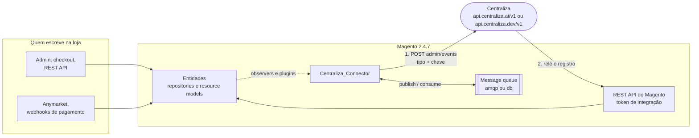
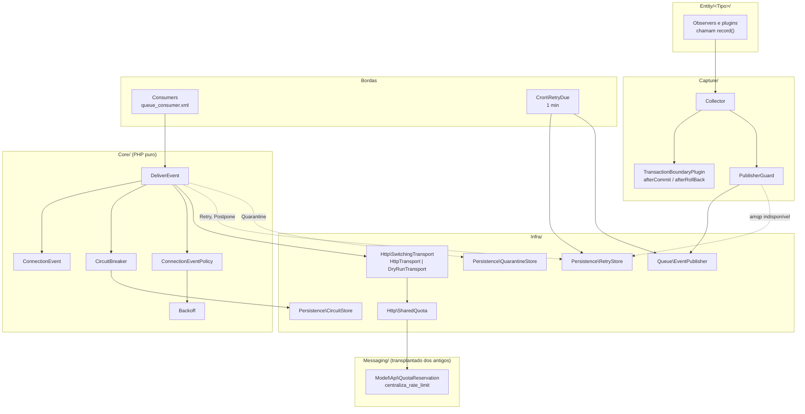
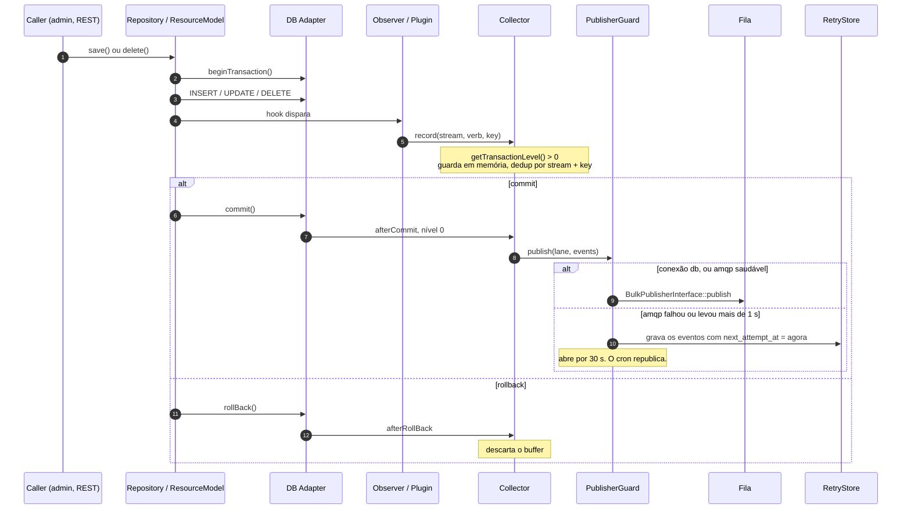
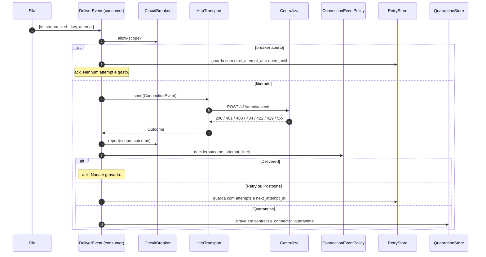
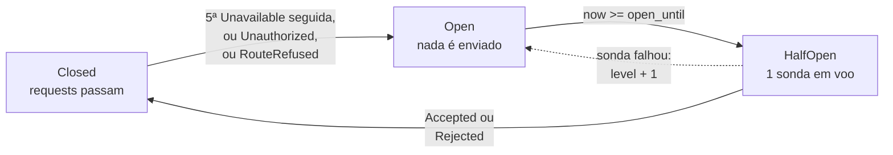
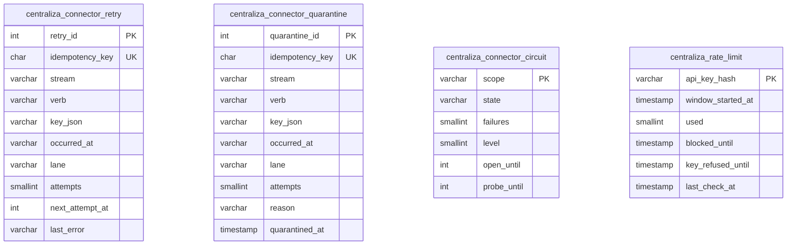

# Centraliza_Connector: arquitetura

Módulo único que substitui `Centraliza_Base`, `Centraliza_Notification` e `Centraliza_Sales`. Avisa o Centraliza, em tempo real, de todo create, update e delete de produto, preço, estoque, cliente e endereços, grupo de clientes, pedido, carrinho (`quote`) e centro de distribuição (MSI Source).

Revisão de 13/11/2026. Substitui o desenho anterior, que previa uma rota nova com snapshot versionado. O contrato agora é o que o Centraliza já documenta em `POST /v1/admin/events`.

Estado da implementação: `products`, `prices`, `stock` e `locations` funcionam de ponta a ponta (captura, fila, consumer, breaker, retry), com 80 testes unitários. O módulo tem dois modos: **simulação** (padrão; cada requisição é gravada em `var/log/centraliza_connector_dry_run.jsonl`) e **live** (`Infra\Http\HttpTransport` faz o `POST /v1/admin/events`). O modo live foi verificado contra um servidor HTTP local que respondeu 200, 500 e 401; ainda não foi usado contra a API do Centraliza.

## Princípios

- **O módulo avisa, o Centraliza lê.** O evento leva o tipo e a chave do registro. O Centraliza relê o registro pela conexão Magento alguns segundos depois, uma vez por rajada, e ignora conteúdo que não mudou.
- **Sem payload no módulo.** Não há mapper, hash de conteúdo, versão nem controle local do que o Centraliza já tem.
- **Fila agnóstica de conexão.** Nenhum `connection=` nos XML de fila. O tópico resolve `amqp` quando `queue/amqp` existe no `env.php` e `db` caso contrário.
- **Sem camada de captura no MySQL.** Não há triggers nem changelog mview. A captura é feita só por observers e plugins.
- **MySQL só na falha.** No caminho feliz o módulo não grava nenhuma tabela própria. Um evento só vai para tabela quando precisa de retry ou morre.

## 1. Contexto



Só o website `base` tem chave e conexão do Centraliza. Entidades do website `shopping_seguranca` não geram evento.

## 2. Contrato: `POST /v1/admin/events`

Fonte: `docs.centraliza.ai/api-reference/event/report-an-event`, mais as páginas de convenções e erros.

```json
{
  "connection": "uuid da conexão em Settings > Channels",
  "source": "magento",
  "type": "stock.updated",
  "idempotency_key": "uuid gerado na captura",
  "occurred_at": "2026-11-13T12:00:00Z",
  "data": {"sku": "LUVA-01", "source_code": "default"}
}
```

| Aspecto | Valor documentado |
|---|---|
| Autenticação | `Authorization: Bearer <chave>` |
| Tipo | `{stream}.created`, `{stream}.updated` ou `{stream}.deleted`, até 96 caracteres |
| `data` | só os campos de chave do registro, sem `contact` |
| `source` | opcional; `^[a-z0-9][a-z0-9_-]*$`, até 64 caracteres. O módulo envia `magento` |
| `idempotency_key` | até 191 caracteres; chave repetida devolve o evento já armazenado com `200` |
| Limite | 6.000 requests por minuto nesta rota, segundo as páginas de convenções e erros; `429` com `Retry-After`. O guia de API keys diz 60 por minuto para as duas APIs. O módulo não fixa o número: obedece ao `429` |
| Delete | `.deleted` aplica a política de remoção do sync flow |
| Respostas | `200`, `401`, `403`, `404`, `422`, `429`, `500`. Erros trazem `message`; o `422` traz também `errors` por campo |

### Streams

A documentação cita `products` (chave `sku`) e `stock` (chave `sku` + `source_code`). Os demais são a nossa proposta e precisam ser confirmados com o Centraliza.

| Stream | Verbos | `data` | Como o Centraliza relê no Magento | Situação |
|---|---|---|---|---|
| `products` | created, updated, deleted | `sku` | `GET /V1/products/:sku` | documentado |
| `stock` | updated, deleted | `sku`, `source_code` | `GET /V1/inventory/source-items` | documentado |
| `prices` | created, updated, deleted | `sku` | `GET /V1/products/:sku`, `POST /V1/products/tier-prices-information` | proposto, implementado |
| `customers` | created, updated, deleted | `customer_id`, `email` | `GET /V1/customers/:id` (traz os endereços) | proposto, implementado |
| `customer_groups` | created, updated, deleted | `group_id`, `code` | `GET /V1/customerGroups/:id` | proposto, implementado |
| `orders` | created, updated | `order_id`, `increment_id` | `GET /V1/orders/:id` | proposto, implementado |
| `carts` | created, updated, deleted | `cart_id` | `GET /V1/carts/:id` | proposto, implementado |
| `locations` | created, updated | `source_code` | `GET /V1/inventory/sources/:code` | proposto, implementado |

Endereço não é stream: uma alteração de endereço gera `customers.updated`. MSI Source não tem delete, só `enabled = 0`, que sai como `locations.updated`.

Os eventos canônicos (`order.status_updated`, `cart.abandoned`, que levam `contact` e disparam automações de WhatsApp) continuam existindo na mesma rota. Ver a seção 8.

## 3. Componentes e dependências

`Core/` não importa `Magento\*` nem Guzzle.



Adicionar uma entidade: os hooks em `Entity/<Tipo>/` e um item no `StreamRegistry` via `di.xml` (stream, lane, campos de chave). Nada muda em `Core/`, nos XML de fila ou nas tabelas.

`Messaging/` é o código dos módulos antigos trazido para cá (mensagens de pedido e carrinho, link de recuperação, validação da chave), com a estrutura original (`Api`, `Model`, `Service`...). Ele não passa por `Core/`: as regras de entrega dele (no máximo uma vez, FIFO por pedido) são outras. O que ele divide com os eventos de conexão é a configuração (`Infra\Config\Settings`) e a cota por chave. Ver [legado.md](legado.md).

## 4. Filas

Exchange padrão `magento`, como os módulos do core, com um binding exato por tópico (a exchange DB não aceita wildcard). Os publishers não declaram conexão. `request="string"`, `Magento\Framework\MessageQueue\Consumer` padrão. Em produção os consumers rodam sob supervisor.

| Tópico = fila = consumer | Streams |
|---|---|
| `centraliza.event.realtime` | `orders`, `customers`, `carts`, `stock`, `customer_groups`, `locations` |
| `centraliza.event.bulk` | `products`, `prices` |
| `centraliza.engagement` | eventos canônicos com `contact` |

Corpo da mensagem: `{v, id, stream, verb, key, at, lane, attempts}`. `id` é a `idempotency_key`, gerada uma vez na captura e mantida em todos os retries.

## 5. Sequência: captura



- O flush depende de `afterCommit` em `Magento\Framework\DB\Adapter\AdapterInterface`, porque um plugin `after` em `save()` roda antes do commit externo quando o chamador abriu a transação.
- O dedup do `Collector` prefere `deleted` sobre `created` sobre `updated` para a mesma chave.
- No delete, a chave (`sku`, `email`) é lida de `getOrigData()` antes de o registro sumir.
- O flush captura qualquer `\Throwable`: ele roda depois do commit do lojista e não pode quebrar a requisição.
- Com a conexão `db`, o publish usa a mesma conexão PDO das entidades e é atômico com a transação.

### Hooks implementados

| Stream | Hook | Regra |
|---|---|---|
| `products` | `catalog_product_save_after` | `created` para produto novo. `updated` só quando o conteúdo muda (atributos que não são de preço, websites, categorias, galeria). Troca de SKU sai como um `updated` com `sku` e `previous_sku` |
| `products` | `catalog_product_delete_before` + `catalog_product_delete_after` | `deleted`. O `before` guarda os websites e os sources do produto, que não são mais legíveis depois |
| `products` | plugin em `ResourceModel\Product\Action::updateAttributes` | `updated` por produto da atualização em massa, quando algum atributo alterado não é de preço |
| `products` | plugin em `Catalog\Model\Product\Action::updateWebsites` | `updated` quando o website adicionado ou removido tem o conector ligado |
| `stock` | plugin `around` em `SourceItemsSaveInterface::execute` | `updated` só quando quantidade ou status diferem do que estava gravado |
| `stock` | plugin em `Command\DecrementSourceItemQty::execute` | `updated` (baixa por pedido, envio e reembolso) |
| `stock` | plugin em `ResourceModel\SourceItem\DeleteMultiple::execute` | `deleted` quando um source é desvinculado de um produto que continua existindo |
| `stock` | plugin `around` nas quatro `InventoryCatalogApi\Api\Bulk*Interface` (atribuir e desatribuir source, transferir estoque) | compara os source items dos SKUs antes e depois da operação: `created`, `updated` ou `deleted` por par SKU + source |
| `stock` | `catalog_product_delete_after` | `deleted` por source do produto apagado, junto com o `products.deleted` |
| `prices` | `catalog_product_save_after` | `created` junto do `products.created`, se o produto tem preço próprio. `updated` quando `price`, `special_price`, `special_from_date`, `special_to_date` ou `tier_price` mudam; um save que só muda preço não gera `products.updated` |
| `prices` | plugin `around` em `BasePriceStorageInterface`, `SpecialPriceStorageInterface` e `TierPriceStorageInterface` (`update`, `replace`, `delete`) | `updated` só para os SKUs cujo preço gravado difere do que estava antes (`PriceSnapshot`) |
| `prices` | plugin em `ResourceModel\Product\Action::updateAttributes` | `updated` por produto quando a atualização em massa inclui atributo de preço |
| `prices` | `customer_group_delete_before` | `updated` para os produtos com tier price do grupo, que o banco remove por FK cascade |
| `prices` | `catalog_product_delete_after` | `deleted` junto do `products.deleted` |
| `locations` | plugin `around` em `SourceRepositoryInterface::save` | `created` ou `updated`, só quando a linha do source ou seus carriers mudam (`LocationSnapshot`) |
| `locations` | plugin `around` em `StockSourceLinksSaveInterface` e `StockSourceLinksDeleteInterface` | `updated` quando o source é vinculado a um stock, desvinculado ou muda de prioridade |
| `customers` | `customer_save_before` + `customer_save_after` | `created` para cliente novo. `updated` só quando o que está gravado muda: `CustomerSnapshot` compara a linha do cliente, seus atributos EAV e seus endereços antes e depois. Login, bloqueio por tentativas e token de redefinição de senha não contam |
| `customers` | `customer_address_save_before/after`, `customer_address_delete_before/after` | `updated` do cliente dono do endereço, pela mesma comparação |
| `customers` | `customer_delete_before` + `customer_delete_after` | `deleted`, com o e-mail e o website lidos antes do delete |
| `customer_groups` | `customer_group_save_after`, `customer_group_delete_after` | `created`, `updated` (só quando código ou classe de imposto mudam) e `deleted` |
| `orders` | `sales_order_save_after` | `created` para pedido novo; `updated` quando algum campo do pedido muda |
| `orders` | `_save_after` de fatura, envio, reembolso, rastreio, comentário e endereço do pedido; `_delete_after` de rastreio | `updated` do pedido dono, mesmo quando a linha do pedido não é regravada |
| `carts` | `sales_quote_save_after` | `created` para carrinho novo, ou quando um carrinho de visitante não reportado ganha cliente. `updated` só quando alguma coluna gravada muda (`CartDiff`); o carrinho é regravado em quase toda requisição da loja |
| `carts` | `_save_after` de item e de endereço do carrinho; `_delete_after` de item | `updated` do carrinho, quando o item ou o endereço mudou de fato |
| `carts` | `sales_quote_delete_after` | `deleted` |

Os observers usam `_save_after` e `_delete_after`, que disparam dentro da transação. Quem garante o envio só depois do commit é o `Collector`.

### Escopo por website

Toda a configuração é por website, e **um website reporta por vez**: o que tem `centraliza_connector/general/enabled` = Sim. Ambiente, chave, channel, modo, tentativas e limites são lidos no escopo dele (`Infra\Config\Settings`); o Default Config é só o que os websites herdam. O admin recusa ligar um segundo website, direto ou pelo Default Config (`Model\Config\Backend\ReportingWebsite`). Se dois ficarem ligados por fora do admin (CLI, SQL), vale o de menor id.

Só geram evento os produtos atribuídos ao website que reporta, e o estoque dos SKUs desses produtos. Clientes seguem o `website_id` do cliente; pedidos e carrinhos, o website da store view em que foram feitos. Grupos de clientes e sources são globais e saem para a conexão do website que reporta. Os campos que variam por store view são lidos na store view padrão desse website.

Na EPI Zeus, o website `base` reporta e o `shopping_seguranca` fica desligado. Para um segundo website usar a Centraliza com outra conexão, cada evento precisaria levar o website e sair para a conexão dele (captura, fila, retry, quarentena, leitura e breaker por website).

Carrinho de visitante só é reportado se `centraliza_connector/carts/guests` estiver ligado para o website. Desligado (padrão), o carrinho passa a ser reportado quando ganha um cliente, e esse primeiro evento sai como `carts.created`.

### O que fica sem cobertura

- **SQL direto** (script, console, outro módulo).
- **Mudanças só em produtos relacionados, opções personalizáveis ou associações de configurável e bundle:** a comparação de conteúdo não as enxerga, então não geram `products.updated`.
- **Estoque após troca de SKU:** o Magento mantém o item de estoque com o SKU antigo até a próxima gravação de estoque. O módulo não gera evento de estoque na troca.
- **Preço promocional por data:** a entrada e a saída de vigência do `special_price` não geram evento; só a gravação das datas gera.
- **Regras de preço de catálogo e `Caravel_Wholesale`:** fora do stream `prices`, que cobre só o preço bruto.
- **`locations` não é filtrado por website:** sources são globais e saem sempre que um website reporta.
- **`customer_groups` não é filtrado por website:** grupos são globais, como os sources.
- **Vários eventos do mesmo carrinho ou pedido na mesma requisição:** o dedup do `Collector` vale por transação. Uma requisição que grava o carrinho em duas transações gera dois `carts.updated`.
- **Limpeza de carrinhos expirados:** o cron do Magento apaga os carrinhos um a um e cada um gera `carts.deleted`.
- **Carrinhos criados pelo próprio Centraliza por REST:** são reportados como qualquer outro (sem supressão de eco).
- **Clientes gravados fora do model do Magento** (importação direta em tabela): sem evento.
- **Pedidos não têm `deleted`:** o Magento não apaga pedidos.

## 6. Sequência: entrega



O handler nunca lança exceção: o `Consumer` padrão trataria como `reject` sem requeue. O cron `centraliza_connector_retry` roda a cada minuto, lê as linhas vencidas do `RetryStore`, republica na fila e as apaga.

### Outcome para Decision

| HTTP | `OutcomeKind` | `Action` | Efeito |
|---|---|---|---|
| 200 | `Accepted` | `Delivered` | ack |
| 400, 422 | `Rejected` | `Quarantine` | vai direto para a quarentena: reenviar o mesmo corpo não muda a resposta |
| 429 | `RateLimited` | `Postpone` | `next_attempt_at` = `Retry-After`; `attempts` inalterado. O breaker passa a `open` até `Retry-After` (mínimo 10 s) sem subir de nível: nenhum processo envia durante a pausa e a sonda seguinte decide |
| 401 | `Unauthorized` | `Postpone` | breaker `key:<hash>` abre |
| 403, 404 | `RouteRefused` | `Postpone` | breaker `route:<hash>` abre |
| 5xx, timeout | `Unavailable` | `Retry` ou `Quarantine` | backoff exponencial com jitter; `Quarantine` em `attempts >= max_attempts` (padrão 5) |

`Cron\RetryDue` roda a cada minuto. Com o breaker fechado, republica em lotes de 500 tudo o que venceu, até esvaziar ou até 45 s de execução. Com o breaker aberto ou em sonda, republica só 5 eventos, o bastante para servir de sonda.

Backoff: `min(3600, 30 * 2^(attempt-1))` segundos, distribuído entre a metade e o valor cheio. `Retry-After` do servidor prevalece quando maior.

### Retry e quarentena

A regra é a mesma de um job de fila com `tries` e `backoff`:

1. **Falhou e ainda há tentativas:** o evento volta para a fila depois de um delay. Como a fila DB do Magento não tem entrega atrasada, o delay é a linha em `centraliza_connector_retry` (`next_attempt_at`); quando vence, `Cron\RetryDue` republica o evento no fim da fila e apaga a linha.
2. **Estourou as tentativas (5 por padrão, configurável), ou a resposta foi `Rejected`:** o evento sai do fluxo e vai para `centraliza_connector_quarantine`, com o motivo. Nada sai da quarentena sozinho.
3. **Uma pessoa revisa a quarentena** e decide:

| Comando | Efeito |
|---|---|
| `bin/magento centraliza:quarantine:list [--limit=50]` | lista id, stream, verbo, chave, tentativas, motivo e data |
| `bin/magento centraliza:quarantine:retry <ids...>` ou `--all` | republica na fila com `attempts = 0` e remove da quarentena |
| `bin/magento centraliza:quarantine:discard <ids...>` ou `--all` | apaga sem enviar |

Só `Unavailable` gasta tentativa. Breaker aberto, `429`, `401`, `403` e `404` adiam o evento sem gastar: o problema é o serviço, a chave ou a rota, não o evento. Cada entrada na quarentena gera um `warning` no log.

Reenviar é seguro por dois motivos: a `idempotency_key` é a mesma em todos os retries, e o evento não carrega conteúdo, só pede que o Centraliza releia o registro.

## 7. Circuit breaker

Estado em `centraliza_connector_circuit`, uma linha por escopo (`host`, `key:<hash>`, `route:<hash>`). As transições são aplicadas por `UPDATE` condicional, para que só um processo vire a sonda em half-open.



| Estado | Evento | Efeito |
|---|---|---|
| `Closed` | `Unavailable` com `failures < 5` | `failures + 1` |
| `Closed` | `Accepted` ou `Rejected` | `failures = 0`, `level = 0` |
| `Open` | `Unavailable` tardia de um request em voo | nenhum; `open_until` não é estendido |
| `HalfOpen` | `probe_until` expirou sem resposta | nova sonda liberada |
| qualquer | `RateLimited` | nenhum |

Duração aberta: `min(900, 30 * 2^level)` segundos, ou `Retry-After` se maior. O `PublisherGuard` é um breaker separado, do lado do produtor, e só age com conexão `amqp`.

## 8. Eventos canônicos

São os eventos da mesma rota que levam `contact` e `data` completo, validados pelo Centraliza, e disparam automações. Usam o mesmo transport e o mesmo breaker dos eventos de conexão, com política própria.

| Tipo | O que faz no Centraliza (segundo a documentação) | Nos módulos atuais | Neste módulo |
|---|---|---|---|
| `order.status_updated` | notifica o cliente da mudança de status | existe | portar |
| `order.created` | encerra fluxos de carrinho abandonado do mesmo carrinho (`data.cart.id` ou `data.order.cart_id`, telefone ou e-mail) | existe, desligado por padrão | portar e ligar |
| `cart.abandoned` | inicia a recuperação de carrinho | existe | portar |
| `cart.recovered` | encerra fluxos de carrinho abandonado do mesmo carrinho | não existe | novo |
| `order.shipped` | não descrito | não existe | novo, a confirmar |
| `contact.created`, `contact.updated` | não descrito | não existe | a decidir (ver seção 10) |
| `checkout.opened` | o módulo da loja informa que o link de checkout foi aberto; avança a jornada de compra do WhatsApp. Só a primeira abertura conta | não existe | novo, no controller do link de carrinho |
| `checkout.started` | o comprador preencheu o checkout; avança a mesma jornada | não existe | novo |

`checkout.opened` e `checkout.started` levam `data.cart.id`. O link de recuperação de carrinho e o callback `/V1/centraliza/notification/sent` são portados dos módulos atuais.

| Aspecto | Eventos de conexão | Eventos canônicos |
|---|---|---|
| Corpo | chave do registro | `contact` + `data` completo |
| Garantia | at-least-once | at-most-once |
| Resposta incerta (timeout após envio) | reenvia | `status = unknown`, nunca reenviado |
| Expiração | não expira | status de pedido desiste após 24 h |
| Persistência | só na falha | linha em `centraliza_connector_engagement`, gravada na transação do pedido |

## 9. Persistência e configuração



`centraliza_connector_retry` só tem eventos esperando a próxima tentativa; `centraliza_connector_quarantine`, os que esgotaram as tentativas ou foram rejeitados. Em operação normal as duas ficam vazias.

`centraliza_rate_limit` é a cota de requisições por chave, compartilhada com as mensagens (ver [legado.md](legado.md#cota-compartilhada)). O módulo também declara, idênticas, as tabelas e colunas dos módulos antigos que as mensagens usam (`centraliza_notification`, `centraliza_sales_*`, `quote.centraliza_masked_id`, `sales_order.centraliza_masked_id`), para que desabilitar os antigos não as apague.

Configuração em Stores > Configuration > Services > Centraliza Connector. Todos os campos são por website (com o Default Config como herança) e nenhum aparece em store view:

| Caminho | Uso |
|---|---|
| `centraliza_connector/general/enabled` | liga o website; um por vez |
| `centraliza_connector/general/mode` | `dry_run` (padrão) ou `live` |
| `centraliza_connector/general/environment` | `production` (app.centraliza.ai, padrão) ou `staging` (app.centraliza.dev); escolhe qual trio abaixo vale |
| `centraliza_connector/general/api_key_{production,staging}` | chave `csk_` de cada ambiente, gravada com `Backend\Encrypted` e marcada como sensível; o admin mostra só a do ambiente selecionado |
| `centraliza_connector/general/connection_id_{production,staging}` | channel ID (UUID da conexão Magento) de cada ambiente |
| `centraliza_connector/carts/guests` | reporta carrinhos sem cliente; padrão Não |
| `centraliza_connector/delivery/max_attempts` | quantas vezes um evento é enviado antes de ir para a quarentena; padrão 5 |
| `centraliza_connector/delivery/request_limit` | requisições por minuto por chave, somando eventos e mensagens; padrão 60; 0 desliga o limite local; acima de 60 vale como 60 enquanto o `Centraliza_Base` estiver habilitado |
| `centraliza_connector/delivery/bulk_quota_floor` | requisições por minuto reservadas para as mensagens; os eventos de conexão param quando restam estas; padrão 30 (de 21 até um a menos que o limite) |
| `centraliza_connector/general/debug` | grava uma linha por requisição de mensagem em `var/log/centraliza.log` |
| `centraliza_connector/connection/{key_hash,workspace_name,validated_at}_{production,staging}` | gravado pelo botão Autenticar (só no escopo de website): estado da validação da chave do website em cada ambiente; as mensagens só saem com a chave validada |
| `centraliza_connector/connection/rejected_keys` | só no Default Config: chaves que a Centraliza recusou, por hash |
| `centraliza_connector/general/base_url_{production,staging}` | sem campo no admin: `https://api.centraliza.ai` e `https://api.centraliza.dev` |

Em modo `live` sem chave ou sem channel ID no ambiente do website, nada é enviado: o evento é retido como em um `401`, sem gastar tentativa. Trocar de ambiente não migra a fila: eventos ainda não entregues saem para o ambiente novo.

`environment`, `mode` e as URLs são marcados como específicos de ambiente (vão para o `env.php` num `app:config:dump`), para HML apontar para staging e produção para produção sem conflito no `config.php`.

### Migração dos módulos antigos

Os módulos antigos (`Centraliza_Base`, `Centraliza_Notification`, `Centraliza_Sales`) continuam instalados e ativos: status de pedido por WhatsApp, carrinho abandonado, link de recuperação de carrinho e callback de entrega ainda vivem neles. Este módulo substitui as notificações de catálogo e está recebendo o resto por transplante, em fases ([legado.md](legado.md)). Enquanto `Centraliza_Sales` estiver habilitado, as mensagens daqui ficam paradas (`Messaging\Model\Config::isReady()`), então o corte é um deploy que desabilita os três no `config.php`.

Desde a fase 1 as tabelas e colunas dos antigos que as mensagens usam estão declaradas aqui também, então desabilitá-los só apaga as 7 tabelas do catálogo antigo. Antes disso, ponha os indexers do catálogo antigo em "Update on Save" (`bin/magento indexer:set-mode realtime centraliza_catalog_product centraliza_catalog_inventory centraliza_catalog_stock_links`), para os triggers deles saírem antes.

Os antigos falam só com produção (`https://api.centraliza.ai/v1/`, fixo no código). A cota por chave é a mesma tabela para os dois (`centraliza_rate_limit`), e os eventos de conexão reservam nela com a prioridade mais baixa: uma rajada daqui não esgota a cota das mensagens de WhatsApp.

```bash
bin/magento centraliza:legacy:import-config --dry-run
bin/magento centraliza:legacy:import-config --connection-id=<uuid> --disable-legacy-catalog
```

O comando importa um website: o que tem a integração antiga ligada com chave, ou o de `--website=<code>`. Tudo é gravado no escopo desse website.

| O que | De | Para |
|---|---|---|
| chave da API | `centraliza/general/api_key` do website (criptografada) | `centraliza_connector/general/api_key_production` do website (recriptografada) |
| website ligado | `centraliza/general/enabled` = 1 no website | `centraliza_connector/general/enabled` = 1 no website |
| channel ID | não existe nos antigos | `--connection-id` → `connection_id_production` do website |
| catálogo antigo (`--disable-legacy-catalog`) | `centraliza/notification/general/enabled` | `0` no escopo default e em todo escopo que tenha valor próprio |

O comando nunca desliga um website no conector e não mexe no `mode` nem no `environment`. Rodar de novo não desfaz nada. Ele para se a integração antiga estiver ligada em mais de um website sem `--website`, ou se outro website já reportar no conector. A chave nunca é impressa, só um fingerprint `sha256:` de 8 caracteres.

## Telas do admin

Menu **Centraliza Connector** (ACL `Centraliza_Connector::centraliza_connector`, separada da configuração, para que dar acesso às telas não dê acesso à chave):

| Tela | Rota | ACL | O que mostra |
|---|---|---|---|
| Painel | `centraliza_connector/dashboard/index` | `::manage` | website que reporta, ambiente, modo, chave verificada, channel ID, limite, circuit breaker, fila por lane, retry, quarentena (com botão "Enviar de novo") e resultados das últimas 24 h; um botão por entidade para enviar todos os registros; os envios recentes |
| Requisições enviadas | `centraliza_connector/delivery/index` | `::deliveries` | grade de `centraliza_connector_delivery_log`: quando, entidade, verbo, chave do registro, resposta, HTTP, o que foi feito depois, tentativa, detalhe, modo, ambiente, duração e atraso desde a mudança |

**Registro de envios.** `DeliverEvent` grava uma linha por requisição feita (ou simulada, em `dry_run`) pela porta `Core\Port\DeliveryLogInterface`. Evento retido sem requisição (sem chave, sem cota: `Outcome::held()`) e registro que sumiu não geram linha. Guarda a chave do registro, não o registro, que é lido de novo a cada tentativa e pode ter dado pessoal. A grade não exporta CSV (a chave de cliente leva o e-mail). O cron `centraliza_connector_clean_delivery_log` (03:40) apaga o que passou de 30 dias.

**Enviar todos os registros de uma entidade** (`Backfill\BackfillService`). O botão grava um pedido em `centraliza_connector_backfill`, e as páginas de chaves (500 por vez) vão para a fila como `<stream>.updated` até a entidade acabar. O controller já põe até 2.000 na hora, então entidade pequena termina antes de a página recarregar. O cron `centraliza_connector_run_backfills` continua a cada minuto, com até 10 mil por execução e 40 s de orçamento, sob lock. Tudo vai na lane `bulk`, qualquer que seja a entidade, para um envio de todos os pedidos não atrasar os pedidos de agora. Quem dita o ritmo das requisições é a fila com a cota compartilhada. Há um envio ativo por entidade; cancelar para de pôr na fila, e o que já está lá ainda sai.

O que cada entidade envia segue as regras da captura: produtos, preços e estoque dos produtos do website; clientes do website; pedidos e carrinhos das store views do website (carrinho só aberto, e de visitante só com `carts/guests`); grupos e origens todos. Uma chave inválida (SKU vazio) é pulada, e o resto da página segue. Se o website que reporta mudar no meio, o envio falha com o motivo.

## Observabilidade (New Relic)

O módulo registra três eventos customizados pela porta `Core\Port\TelemetryInterface`. O adaptador `Infra\Telemetry\NewRelicTelemetry` usa `newrelic_record_custom_event`; sem a extensão do agente carregada, nada acontece. Nenhum evento leva o `record`, que pode conter dado pessoal.

Todo evento leva também `storeHost` (host da store view que reporta), `mode` (`live` ou `dry_run`) e `environment` (`production` ou `staging`). O nome de aplicação do New Relic é compartilhado entre lojas, então toda consulta deve filtrar ou agrupar por `storeHost`.

| Evento | Quando | Atributos |
|---|---|---|
| `CentralizaDelivery` | um por evento tirado da fila | `stream`, `verb`, `lane`, `action` (`delivered`, `retry`, `postpone`, `quarantine`, `skipped`), `outcome` (`accepted`, `rejected`, `rate_limited`, `unauthorized`, `route_refused`, `unavailable`, `circuit_open`, `record_gone`, `record_unreadable`), `detail` (até 200 caracteres, ex. `HTTP 503`), `attempts` (falhas anteriores), `readMs` (leitura do registro), `sendMs` (chamada HTTP), `lagSeconds` (da mudança na loja até agora) |
| `CentralizaCircuit` | a cada mudança de estado do circuit breaker | `scope`, `from`, `to`, `level`, `openSeconds` |
| `CentralizaHealth` | a cada minuto, pelo cron `centraliza_connector_report_health` | `circuit`, `circuitLevel`, `held` (aguardando nova tentativa), `heldOldestSeconds`, `quarantined`, `waitingRealtime` e `waitingBulk` (só com fila DB; com RabbitMQ a profundidade vem do broker) |

O consumer é um processo PHP sem fim, e o agente só envia o que juntou quando uma transação termina. Por isso `Infra\Queue\Consumer` abre uma transação de background por mensagem (`Centraliza/deliver`) e a encerra ao final.

### Consultas para painel

```sql
-- Volume por resultado
SELECT count(*) FROM CentralizaDelivery WHERE storeHost = 'www.epizeus.com.br' FACET action TIMESERIES

-- Taxa de erro de envio
SELECT percentage(count(*), WHERE outcome NOT IN ('accepted', 'record_gone')) FROM CentralizaDelivery WHERE storeHost = 'www.epizeus.com.br' AND sendMs IS NOT NULL TIMESERIES

-- Latência do Centraliza e custo de leitura do registro, por stream
SELECT percentile(sendMs, 50, 95), percentile(readMs, 50, 95) FROM CentralizaDelivery WHERE storeHost = 'www.epizeus.com.br' FACET stream

-- Atraso da mudança até a entrega
SELECT percentile(lagSeconds, 50, 95, 99) FROM CentralizaDelivery WHERE storeHost = 'www.epizeus.com.br' AND action = 'delivered' TIMESERIES

-- Fila, retidos e quarentena
SELECT latest(waitingRealtime), latest(waitingBulk), latest(held), latest(quarantined) FROM CentralizaHealth WHERE storeHost = 'www.epizeus.com.br' TIMESERIES
```

### Alertas (destino: Caravel)

As condições são criadas no New Relic, em uma policy com notificação para a Caravel. O módulo não as cria.

| Alerta | Condição NRQL | Limiar sugerido |
|---|---|---|
| Circuito aberto | `SELECT count(*) FROM CentralizaHealth WHERE circuit != 'closed' FACET storeHost` | > 0 por 10 min |
| Evento em quarentena | `SELECT latest(quarantined) FROM CentralizaHealth FACET storeHost` | > 0 |
| Chave ou rota recusada | `SELECT count(*) FROM CentralizaDelivery WHERE outcome IN ('unauthorized', 'route_refused') FACET storeHost` | > 0 por 5 min |
| Fila parada | `SELECT latest(waitingRealtime) + latest(waitingBulk) FROM CentralizaHealth FACET storeHost` | > 1000 por 15 min |
| Retidos envelhecendo | `SELECT latest(heldOldestSeconds) FROM CentralizaHealth FACET storeHost` | > 1800 |
| Atraso alto | `SELECT percentile(lagSeconds, 95) FROM CentralizaDelivery WHERE action = 'delivered' FACET storeHost` | > 600 por 15 min |
| Cron parado | `SELECT count(*) FROM CentralizaHealth FACET storeHost` | perda de sinal por 5 min |
| Registro ilegível | `SELECT count(*) FROM CentralizaDelivery WHERE outcome = 'record_unreadable' FACET storeHost` | > 0 |

## 10. Pendências com o time do Centraliza

1. Confirmar os streams propostos na seção 2 e os campos de chave de cada um. **Teste em staging (17/11/2026):** `products`, `prices` e `stock` são aceitos (200). `locations`, `customers`, `customer_groups`, `orders` e `carts` voltam 422 "The connection has no stream named …": precisam ser criados na conexão Magento do lado da Centraliza. Os erros de `contact` que vêm junto são consequência: um tipo que não é stream da conexão é tratado como evento comum, que exige contato; os streams aceitos não pedem contato.
2. O guia do conector Magento descreve produtos e estoque indo do Centraliza para o Magento. Confirmar que os streams `products`, `prices` e `stock` aceitam o Magento como origem.
3. `created` e `updated` têm tratamento diferente, ou basta enviar `updated`?
4. A releitura usa a REST do Magento com o token de integração do conector? Para `carts` e `locations` o token precisa dos recursos `Magento_Cart::manage` e `Magento_InventoryApi::source`.
5. Para `.deleted`, qual política de remoção se aplica a cada stream?
6. ~~O campo `connection` é o `id` do canal devolvido por `GET /v1/admin/channels`?~~ Não: esse `id` é o código do tipo de canal (`magento`), e a API recusa ("must be a valid UUID"). O `connection` é o UUID da conexão, que aparece no painel (Settings > Channels > Magento) e não é exposto pela Admin API (`/v1/admin/connections` dá 404).
7. Clientes: usar o stream `customers` ou os eventos canônicos `contact.created` e `contact.updated`? Os dois existem e não está dito como se relacionam.
8. Pedidos: o conector Magento do Centraliza já importa pedidos por polling a cada 15 minutos. Um evento `orders.updated` antecipa essa leitura, ou é ignorado?
9. A Admin API não tem rota de criação de `locations` nem de `orders` (só leitura e, para pedidos, update e delete). O stream `locations` existe?
10. Qual é o limite real de `POST /v1/admin/events`: 6.000 por minuto (convenções) ou 60 (guia de API keys)? Os módulos antigos mediram 60 por chave, e é o padrão de `request_limit`: os eventos ficam com ~30 por minuto, o resto fica para as mensagens. Dá para ter um limite maior ou uma cota separada para os eventos?

## 11. Limites conhecidos

- Escrita por SQL direto não gera evento.
- Um processo morto entre o commit e o publish, com conexão `amqp`, perde o evento. Com conexão `db` isso não acontece, porque o publish está na mesma transação.
- O módulo não sabe se o Centraliza processou o evento, só que o aceitou (`200`).
- Vazão: com a cota por chave dividida com as mensagens, os eventos saem a no máximo `request_limit - bulk_quota_floor` por minuto (30 no padrão, 60 - 30).
